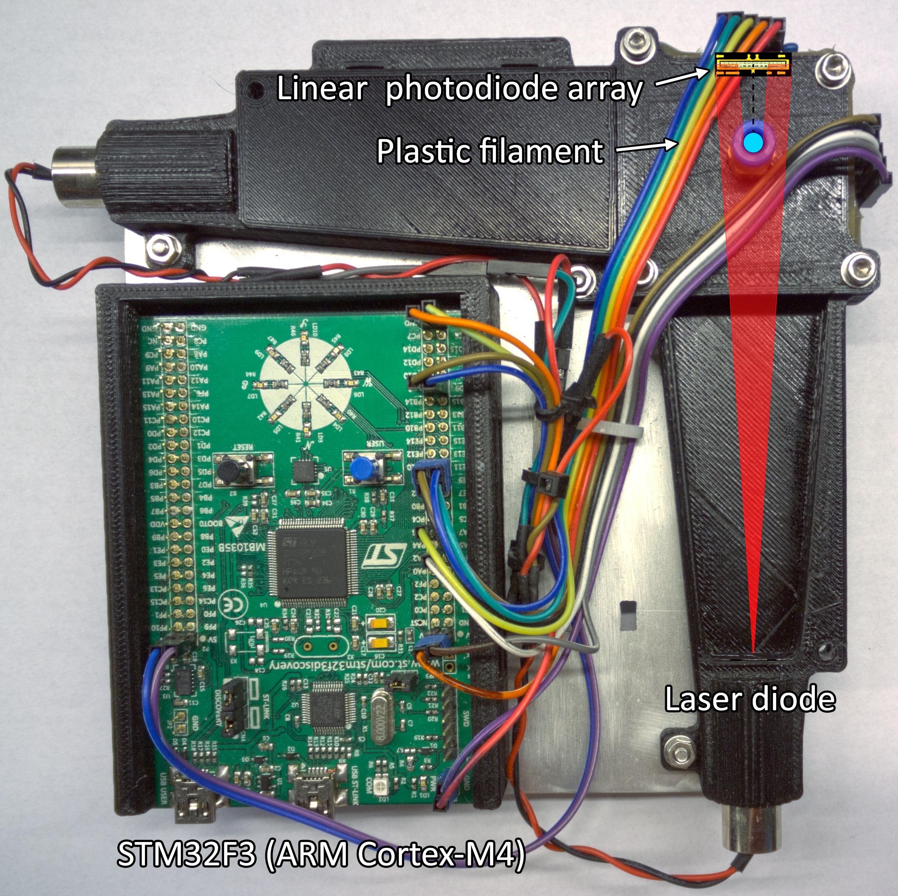
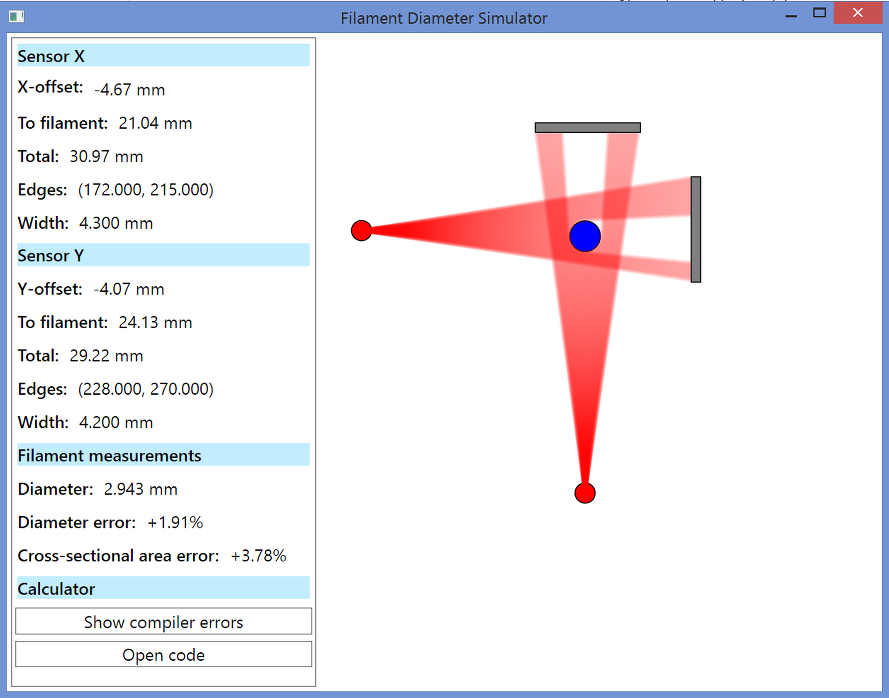
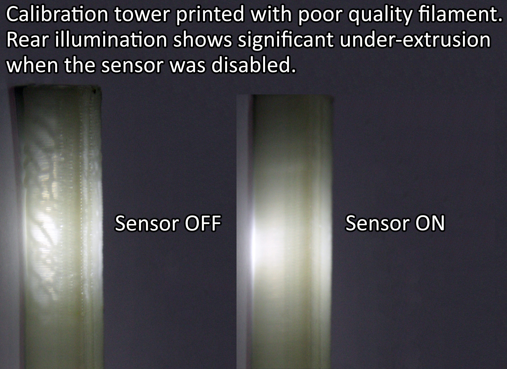

# FilamentDiameterSensor

ENPH 459 - Engineering Physics Project I
----------------------------------------
A Non-contact Diameter Measurement Device for 3D Printers and Filament Manufacturing

The filament diameter sensor is based on the STM32F4 and uses a two-axis optical sensor to get an accurate measurement of filament diameter without contacting the filament.
This makes the sensor especially suited for filament production since it can measure filament diameter even when it is soft and not able to be measured with physical methods.

The sensor uses two laser diodes as coherent light sources and two photodiode arrays (like a single row camera) which rapidly measure the diameter.

The project includes a simulator which models the optical system and allows different measurement functions to be tested with it.

When used with a special build of Marlin firmware, print quality improves significantly.

### File Organization ###

1.  *Arduino* - 
    Initial prototype was implemented for Arduino.

2.  *Code* - 
    Includes the rest of the project's (non-MATLAB) code. Several versions of the shadow-simulator, a fork of the printer firmware Marlin(modified to interface with the filament sensor), and the sensor's firmware to be run on a STM32F3 development board.
    
3.  *Eagle* - 
    PCB layout files for the photodiode array (TSL1402CL) breakout board.
    
4.  *Matlab* - 
    Matlab script used to measure the relative print quality based on the roughness of vertical printed edges.

5.  *Pictures* - 
    Pictures from the sensor development and print quality testing.

6.  *Reference Documents* - 
    Documentation for the STM32F3 development board, the linear photodiode array used in the sensor, and the prototype sensor.
    
7.  *Solidworks* - 
    All 3D design for the sensor, mostly Solidworks with some .STL-rasterized models for 3D printing.
